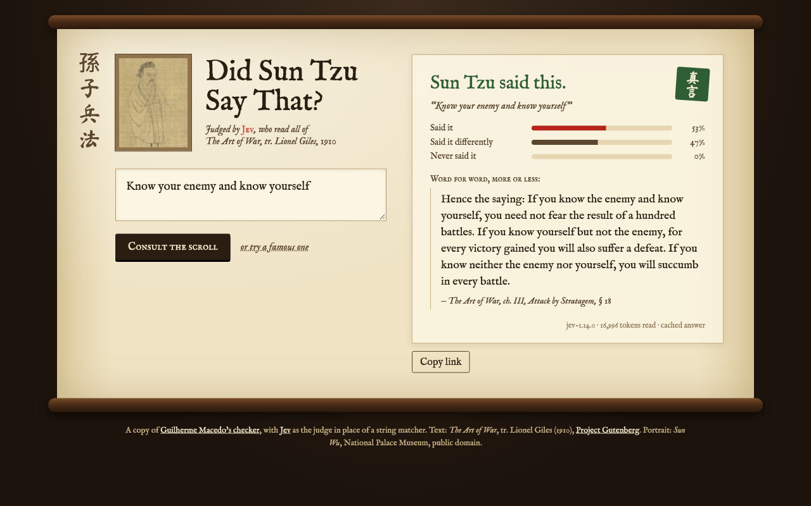
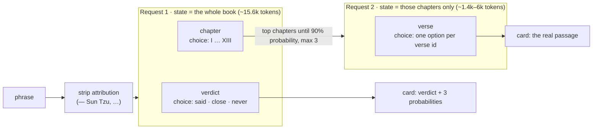

# Did Sun Tzu Say That? — Jev edition

Paste a phrase. [Jev](https://docs.typesafe.ai) reads all of *The Art of War* (Lionel Giles, 1910)
and tells you if Sun Tzu said it, said it in other words, or never said it.



This is a copy of [Guilherme Macedo's checker](https://guilherme01macedo.github.io/maybe-sun-tzu/)
([source](https://github.com/guilherme01macedo/maybe-sun-tzu)). His app compares words with a
string matcher. This one asks a model instead.

## Why Jev fits this problem

Jev is a *System One* model. It does not write text. You give it a `state` (the content to read)
and typed questions, and it returns structured answers with a probability for each option.

The question "is this phrase in the book?" is exactly that shape:

| What we need | Jev primitive |
| --- | --- |
| One of three verdicts: said it / said it differently / never said it | `choice` with 3 options |
| Which passage is the closest | `choice` with one option per verse |
| How sure the answer is | the `probabilities` that come with every Choice |

The whole book fits in one request. It has 383 verses, about 15k tokens. Jev reads up to
32k tokens per question and 64k per request, so we send the full book every time. No search
index, no embeddings, no chunking.

## How a check works



### Request 1: the verdict, on the whole book

The `state` is the book, one line per verse, with the verse id at the start:

```
Chapter III. Attack by Stratagem
III.1| Sun Tzu said: In the practical art of war, the best thing of all is to take the enemy's country whole and intact; …
III.2| Hence to fight and conquer in all your battles is not supreme excellence; …
```

Two questions go with it. They are independent, so they share one request and Jev reads the
book only once:

```jsonc
{
  "model": "jev-1.14.0",
  "state": "<the tagged book>",
  "questions": {
    "verdict": {
      "type": "choice",
      "instructions": {
        "phrase": "Know your enemy and know yourself",
        "question": "The book in `state` is The Art of War by Sun Tzu (translated by Lionel Giles). Does Sun Tzu say `phrase` in this book?"
      },
      "criteria": {
        "said":  "A verse of the book contains this phrase word for word. Small differences still count as word for word: spelling, punctuation, capital letters, articles such as 'the' or 'a', singular or plural, or a few words left out.",
        "close": "No verse contains these words, but a verse states the same idea in different words. Examples: a paraphrase, a shortened version, modern wording, or the words in a different order.",
        "never": "No verse of the book states this idea. The phrase comes from somewhere else or is invented, even when its topic is war, strategy, or enemies."
      }
    },
    "chapter": {
      "type": "choice",
      "instructions": { "phrase": "…", "question": "Which chapter of the book in `state` has the verse closest in meaning to `phrase`?" },
      "criteria": { "I": "Laying Plans", "II": "Waging War", "…": "…", "XIII": "The Use of Spies" }
    }
  }
}
```

Choices that matter:

- **The phrase goes in `instructions`, not in `state`.** The state is the same for every user, and
  the phrase is the question about it. This follows TypeSafe's
  [line-by-line search cookbook](https://docs.typesafe.ai/cookbooks/semantic_find).
- **Each verdict is written literally.** Jev reads criteria at face value, so each option says
  exactly what counts and what does not ("even when its topic is war"). Each option stands on
  its own.
- **A Choice, not a Score.** The three verdicts are categories, not points on a scale. A Choice
  also gives a probability per verdict, and the card shows all three.

### Request 2: the passage, on the picked chapters only

A Choice accepts at most 255 options, and the book has 383 verses. So the verse search takes a
second, small request. Its state is only the chapters that request 1 picked (the top ones until
their probabilities add up to 90%, at most 3). Its one question has one option per verse id:

```jsonc
{
  "state": "<the tagged verses of the picked chapters>",
  "questions": {
    "verse": {
      "type": "choice",
      "instructions": { "phrase": "…", "question": "Which verse in `state` is closest in meaning to `phrase`?" },
      "criteria": { "III.1": null, "III.2": null, "…": null, "III.18": null }
    }
  }
}
```

The options are `null` because the state already holds the text of each id.

### What the code still does

Jev makes the judgement. Ordinary code does the rest:

- remove attributions such as `— Sun Tzu, The Art of War` before asking;
- pick the chapters from the probabilities;
- map the answer ids back to the verse text;
- reuse answers: `data/jev-cache.json` holds the answers that `pnpm eval` recorded, and the server
  keeps new answers in memory (at most 2,000), so a phrase that someone already checked costs nothing.

## Results

`pnpm eval` runs 22 labelled phrases from Guilherme's tests. `pnpm eval --reversed` also asks the
verdict with the options in reverse order. If Jev preferred the first option, the verdicts would change.

| Model | Correct verdict | Correct passage | Verdict changes when the order is reversed |
| --- | --- | --- | --- |
| `jev-1.13.0` | 19 / 22 | 13 / 13 | 1 / 22 |
| `jev-1.14.0` (default) | 19–20 / 22 | 13 / 13 | 0–1 / 22 (the 53/47 case below) |

The misses are borderline cases. The probabilities show this:

| Phrase | Label | Jev | Why |
| --- | --- | --- | --- |
| Attack where they are unprepared, appear where you are not expected | close | said 69–75% | I.24 is "Attack him where he is unprepared, appear where you are not expected." |
| Know your enemy and know yourself | close | said 53%, close 47% | III.18 contains "know the enemy and know yourself". |
| Be like water my friend | never | close ~80% | A Bruce Lee line, but VI.29 says "Military tactics are like unto water". |

## Cost and speed

- One check reads 17k–22k input tokens (19k on average). Jev costs $0.042 per million input tokens, and output
  is free, so a check costs about **$0.0008**. A phrase that is in the cache costs nothing.
- One live check took 0.6 s (one sample, not a benchmark).

## Run it

You need Node 22 or later, pnpm, and a TypeSafe API key.

```sh
pnpm install
TYPESAFE_API_KEY=... pnpm start   # http://localhost:8787
pnpm test                         # offline: never calls the API
pnpm eval [--reversed]            # uses data/jev-cache.json; records new answers if a key is set
```

- The key is read only on the server, from `TYPESAFE_API_KEY`. The browser calls `/api/judge`
  and never sees the key. Thus the app cannot run on a static host such as GitHub Pages: it needs
  any host that runs Node.
- Without a key, the server answers only the phrases in `data/jev-cache.json`.
- `JEV_MODEL` changes the model (default `jev-1.14.0`).
- The server limits each IP address to 20 checks per minute.
- The server never writes to disk. Only `pnpm eval` adds answers to `data/jev-cache.json`.
- A request body is at most 4 KB, and a phrase at most 500 characters.

## Files

| Path | What it does |
| --- | --- |
| `src/judge.ts` | The two Jev requests and the questions. Start here. |
| `src/jev.ts` | The TypeSafe client and the record/replay cache. |
| `src/server.ts` | `node:http` server: static files and `POST /api/judge`. |
| `src/client/app.ts` | The page script (served as JavaScript through esbuild). |
| `data/passages.json` | The 383 verses, from Guilherme's build of Project Gutenberg #132. |
| `test/cases.ts` | The labelled phrases for `pnpm eval`. |

## Credits

- Idea, design and `data/passages.json`: [Guilherme Macedo](https://github.com/guilherme01macedo/maybe-sun-tzu).
- Text: *The Art of War*, tr. Lionel Giles (1910), [Project Gutenberg #132](https://www.gutenberg.org/ebooks/132), public domain.
- Portrait: *Sun Wu*, National Palace Museum, public domain.
- Judge: [Jev](https://docs.typesafe.ai) by TypeSafe.
